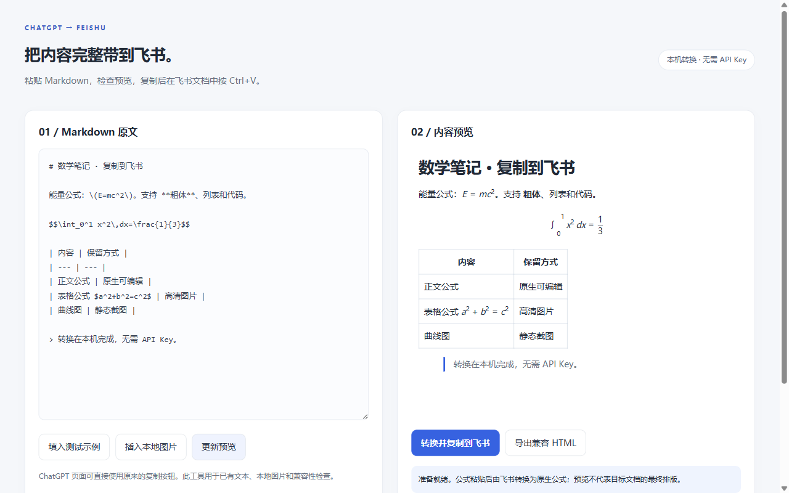

# ChatGPT → 飞书 · 公式图片复制 v1.1.2

[](https://github.com/YijiaQian/chatgpt-feishu-copy/actions/workflows/check.yml)
[](LICENSE)

把 ChatGPT 回复中的 Markdown、LaTeX、表格、图片和可读取的图表，转换成适合飞书文档粘贴的富文本。支持增强 ChatGPT 原生复制按钮，也提供独立 Markdown 转换工具。无需 API Key 或飞书应用凭据。

这是独立开源工具，与 OpenAI、飞书、Google 或 Microsoft 没有隶属或官方合作关系。当前提供手动安装包；尚未上架 Chrome 或 Edge 插件市场。

- [下载最新版本](https://github.com/YijiaQian/chatgpt-feishu-copy/releases/latest)
- [隐私说明](https://github.com/YijiaQian/chatgpt-feishu-copy/blob/main/PRIVACY.md)
- [报告问题](https://github.com/YijiaQian/chatgpt-feishu-copy/issues)
- [参与开发](CONTRIBUTING.md) · [商店发布材料](docs/store-listing.zh-CN.md)
- [产品需求文档与架构流程图](docs/PRD.zh-CN.md)



## 从旧版更新

先停用旧版，解压新版，再加载新版的 `chatgpt-feishu-copy` 文件夹，最后刷新 ChatGPT 对话页。若覆盖原文件夹，则在扩展管理页点击该扩展的「重新加载」，再刷新对话页。

新版支持当前 ChatGPT 的 `data-turn-key` / `assistant-message` 消息结构。回复工具栏中会出现文档导出图标，悬停显示「复制到飞书 · 含公式和图表」，外观与原生按钮一致。点击浏览器扩展图标还可以查看当前页面是否已连接 v1.1.2；没有连接时点击「检查并启用当前页面」。

已用实际 ChatGPT 对话中的自带复制按钮验证：35 个公式、2 张原始 Recharts 曲线图和 4 个表格公式图片进入剪贴板，粘贴到真实飞书文档后保存为 31 个原生公式和 6 个图片块。

本地运行的 Chrome / Edge 浏览器扩展。点击 ChatGPT 回复下方原有的复制按钮，生成适合飞书文档粘贴的富文本。无需 API Key、飞书 App Secret 或服务器。

## 安装

1. 解压安装包，保留整个 `chatgpt-feishu-copy` 文件夹。
2. Chrome 打开 `chrome://extensions`；Edge 打开 `edge://extensions`。
3. 开启「开发者模式」，点击「加载已解压的扩展程序」。
4. 选择包含 `manifest.json` 的文件夹。
5. 刷新 ChatGPT 网页，可以将扩展固定到浏览器工具栏。

本包尚未上架商店。已在独立测试浏览器加载。`manual.zip` 用于手动安装；`store.zip` 用于商店后台上传，其 manifest 位于 ZIP 根目录。

## 使用

在 `chatgpt.com` 或 `chat.openai.com` 点击回复下方原来的复制按钮。等到「已复制飞书格式」提示后，在可编辑的飞书文档按 **Ctrl+V 普通粘贴**。

- **Alt + 点击复制**：使用 ChatGPT 原始复制。
- 普通程序代码块的复制保持原行为；Markdown 代码块的复制会转换该代码块。
- 点击扩展图标可关闭增强复制、控制图片嵌入，或打开独立转换工具。
- 独立工具支持已有 Markdown、本地图片、预览、复制与导出兼容 HTML。
- SVG / Recharts 曲线图和可读取的 Canvas 图表会整张截图为 PNG，保留曲线、坐标轴及图例。

仅复制成纯 Markdown 后，如果内容里只剩 `Chart` 和图例，原始图表数据已经丢失，无法从这些文字自动还原原图。请直接从原始 ChatGPT 网页复制，或通过「插入本地图片」补入图表。新版会明确提示这类缺失。跨域 iframe 内的图表仍需先下载或导出原图。

图片加载完成后再复制。转换完成前保持页面在前台；图片较多时需要等待几秒。

## 保留方式

| 内容 | 飞书中的结果 |
| --- | --- |
| 标题、段落、粗体、斜体、删除线、链接 | 原生文本及样式 |
| 正文行内公式、独立公式 | 飞书原生可编辑公式 |
| `\(...\)`、`\[...\]`、`$...$`、`$$...$$` | 统一为飞书识别的公式分隔符 |
| Markdown 表格 | 飞书原生文档表格 |
| 表格单元格公式 | 本地生成的 3 倍分辨率 PNG |
| 有序 / 无序 / 嵌套列表、引用 | 对应原生结构 |
| 代码块 | 原生代码块，保留语言标识与源码 |
| 可读取的生成图片、普通图片 | 嵌入图片，粘贴时由飞书上传到文档 |
| SVG 图标、已渲染的 SVG 示意图 | 本地栅格化为 PNG |
| Emoji 图标 | Unicode 字符 |

飞书当前粘贴转换不自动处理表格单元格的 LaTeX，因此表格公式使用图片保证显示。兼容 HTML 的图片说明保留公式源码，但飞书不一定保留该说明；需要继续编辑时请保留原 Markdown 或导出的 HTML。正文公式保持可编辑。

## 图片与兼容范围

默认支持 ChatGPT 及 OpenAI 素材域名。外部图片下载失败时，可在转换工具底部填写该图片域名，例如 `https://example.com`，再点击授权，仅申请该域名权限。

需登录、过期或受组织策略限制的图片，以及无法读取的跨域画布，可能仍需下载后通过转换工具插入。失败会明确提示，并尽可能保留原图链接。

单张原图限制 16 MB，图片宽度最多约 2000 像素，总嵌入量限制约 24 MB，超出请分段复制。动图保留一帧，SVG 转换后作为位图。未渲染的 Mermaid 等图表源码保留在代码块，不执行图表源码。

验证环境：Windows 11、Chrome for Testing 143、已登录的真实 ChatGPT 对话、DOM 回归夹具、真实飞书网页版文档。ChatGPT 桌面客户端、手机端、Firefox、Safari、飞书桌面客户端没有经过本次实测。网页结构或飞书导入逻辑变化后可能需要更新扩展。

## 验证

2026-10-19：15 项内核检查、4 项原有按钮集成检查、2 项新版消息结构与图表集成检查通过。已在用户提供的真实 ChatGPT 对话中点击原生复制按钮，随后在专用飞书测试文档通过浏览器 Ctrl+V 实际粘贴，再用 lark-cli 回读结构。没有向原 ChatGPT 对话发送测试消息。

测试文档中的全文由浏览器粘贴形成，另以 lark-cli 回读确认原生公式及图片块结构。开源仓库不包含私有对话、测试文档地址、登录配置或浏览器用户数据。

2026-10-20：内核 15 项检查再次通过；v1.1.1 的图标复制已在真实 ChatGPT 页面验收。v1.1.2 增加隐私说明并收窄固定网站权限，转换算法保持一致。

本地检查不需要飞书凭据，也不写在线文档：

```text
python -m pip install playwright
python -m playwright install chromium
python tests/run_tests.py --work-dir work/test-tmp
```

可用 `--browser` 指定本地 Chromium 可执行文件。

## 数据和权限

`clipboardWrite` 用于用户点击后写入富文本和纯文本剪贴板；`storage` 保存开关及上次统计；`offscreen` 在本地处理图片与表格公式；`scripting` 用于用户点击「启用当前页面」后重新连接 ChatGPT。固定网站权限用于读取待复制的 ChatGPT 回复和相关素材，可选网站权限只由用户主动授予其他图片域名。

没有分析统计服务、自建上传服务器或 ChatGPT / 飞书 API 调用。网络请求用于读取素材原地址；转换页预览也可能加载 Markdown 内的远程图片。正常粘贴时由飞书自身上传图片。正文不会作为草稿持久保存，但最近一次转换警告可能包含图片说明、域名或出错公式片段。浏览器或组织禁用富文本剪贴板时无法绕过。完整数据处理和清理方式见 [privacy.html](privacy.html)。

## 源码和依赖

`content.js` 适配复制按钮，`charts.js` 捕获 SVG / Canvas 图表，`core.js` 转换结构和剪贴板，`background.js` 下载图片，`offscreen.js` 本地栅格化，`converter.html` 是独立工具，`tests/` 是可复现内核检查。无需构建，源码直接加载。

运行 `python scripts/package.py`，会在 `dist/` 生成商店包、手动安装包及 SHA-256 校验文件。打包使用固定文件清单，不包含测试、Git 历史、开发配置或私有验收材料。项目自身代码采用 [MIT](LICENSE) 许可，依赖采用各自许可，详见 [THIRD_PARTY_NOTICES.md](THIRD_PARTY_NOTICES.md)。

公式支持参考[飞书公式说明](https://www.feishu.cn/hc/zh-CN/articles/894598450617-在文档中使用公式)；扩展架构参考 [Chrome Offscreen API](https://developer.chrome.com/docs/extensions/reference/api/offscreen)。表格标记和图片尺寸属性通过本次真实飞书行为及公开页面脚本核对。

新写源码采用 MIT 许可证。所有 JavaScript 和字体随包提供，不从 CDN 加载可执行代码。依赖许可证见 `THIRD_PARTY_NOTICES.md` 和 `vendor/`。
