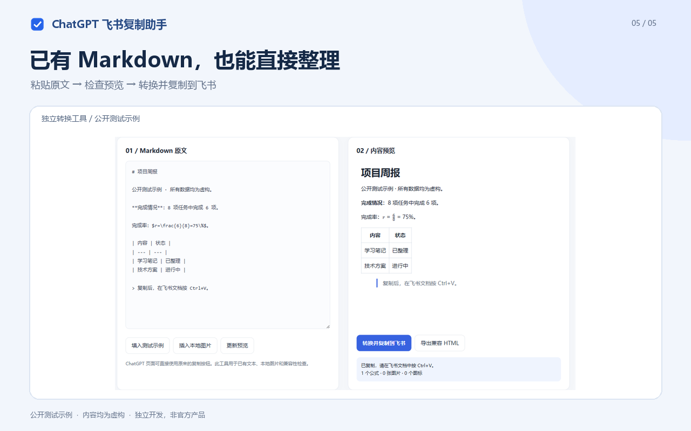

# ChatGPT 飞书复制助手 v1.2.6

把 ChatGPT 回复中的 Markdown、LaTeX、表格、图片和可读取的图表，转换成适合飞书文档粘贴的富文本。支持增强原生复制按钮、整段会话导出到本地，以及独立 Markdown 转换工具。无需 API Key 或飞书应用凭据。

这是独立开源工具，与 OpenAI、飞书、Google 或 Microsoft 没有隶属或官方合作关系。已上架 [Chrome 应用商店](https://chromewebstore.google.com/detail/lioeeehlohnekghgohhagbammgbbcbfn)，也提供手动安装包；Edge 商店尚未提交。

- [下载最新版本](https://github.com/YijiaQian/chatgpt-feishu-copy/releases/latest)
- [隐私说明](https://github.com/YijiaQian/chatgpt-feishu-copy/blob/main/PRIVACY.md)
- [报告问题](https://github.com/YijiaQian/chatgpt-feishu-copy/issues)
- [参与开发](CONTRIBUTING.md) · [文档导航](docs/README.md) · [商店发布材料](docs/store-listing.zh-CN.md)
- [产品需求文档与架构流程图](docs/PRD.zh-CN.md)
- [整段会话离线导出设计与验收](docs/conversation-export.zh-CN.md)

## 从旧版更新

先停用旧版，解压新版，再加载新版的 `chatgpt-feishu-copy` 文件夹，最后刷新 ChatGPT 对话页。若覆盖原文件夹，则在扩展管理页点击该扩展的「重新加载」，再刷新对话页。

新版支持当前 ChatGPT 的 `data-turn-key` / `assistant-message` 消息结构。回复工具栏中会出现文档导出图标，悬停显示「复制到飞书 · 含公式和图表」，外观与原生按钮一致。点击浏览器扩展图标还可以查看当前页面是否已连接当前扩展版本；没有连接时点击「检查并启用当前页面」。

## 安装

1. 解压安装包，保留整个 `chatgpt-feishu-copy` 文件夹。
2. Chrome 打开 `chrome://extensions`；Edge 打开 `edge://extensions`。
3. 开启「开发者模式」，点击「加载已解压的扩展程序」。
4. 选择包含 `manifest.json` 的文件夹。
5. 刷新 ChatGPT 网页，可以将扩展固定到浏览器工具栏。

v1.2.6 是文档与开发维护工具更新，转换行为和浏览器权限保持不变。该版通过 GitHub 手动安装包分发，未向应用商店提审。商店上架与审核的历史状态见 [v1.2.5 商店更新记录](docs/store-update-v1.2.5.zh-CN.md)，当前结果以商店后台为准。GitHub Release 只提供手动加载的 `manual.zip` 及对应校验值；`store.zip` 仅用于本地商店上传，其 manifest 位于 ZIP 根目录。

## 使用

在 `chatgpt.com` 或 `chat.openai.com` 点击回复下方原来的复制按钮。等到「已复制飞书格式」提示后，在可编辑的飞书文档按 **Ctrl+V 普通粘贴**。

- **Alt + 点击复制**：使用 ChatGPT 原始复制。
- 程序代码块的“复制代码”同时携带飞书代码块格式和原始纯文本：粘贴到飞书是可编辑代码块，粘贴到代码编辑器仍是源码。按住 Alt 点击可使用网站原始复制。
- Markdown 代码块的复制默认会转换其中的 Markdown；可在弹窗关闭该选项，改为保留 Markdown 代码块。
- 点击扩展图标可关闭增强复制、控制图片嵌入，或打开独立转换工具。
- 独立工具支持已有 Markdown、本地图片、预览、复制与导出兼容 HTML。
- SVG / Recharts 曲线图和可读取的 Canvas 图表会整张截图为 PNG，保留曲线、坐标轴及图例。
- 流程、并排数字卡片和进度条等视觉布局会整组转换为 PNG，保留文字、背景及箭头。识别结合 ChatGPT 组件标记与 Grid / Flex 卡片样式，不依赖具体文案。
- 截图范围限定在独立图形组件或直接卡片组；同一回复中的标题、正文、正文公式、表格和代码仍保留为可编辑内容。图形组件内部的公式先独立渲染，再合入组件图片。
- 新版组件中的强调文字转换为原生粗体；表格使用明确的列宽并保留源列宽比例，避免所有列都退回窄列。
- 含单选项、滑块的独立计算卡片保留为当前状态的静态图片，包括选中项和金额；粘贴后无法继续交互，修改参数后需重新复制。
- 费用摘要和时间结构连同标题、金额一起保存；百分比尺寸 SVG 按网页显示尺寸生成清晰图片。独立有序列表明确重置编号，图标旁的说明正文保持可编辑。
- 正文中的内联可点击词条保留文字。网站仅通过弹窗提供、没有实际链接地址的词条仍为文字。

仅复制成纯 Markdown 后，如果内容里只剩 `Chart` 和图例，原始图表数据已经丢失，无法从这些文字自动还原原图。请直接从原始 ChatGPT 网页复制，或通过「插入本地图片」补入图表。新版会明确提示这类缺失。跨域 iframe 内的图表仍需先下载或导出原图。

图片加载完成后再复制。转换完成前保持页面在前台；图片较多时需要等待几秒。

## 导出完整当前会话

1. 打开已有的 ChatGPT 对话，等待当前回复生成结束。
2. 点击浏览器扩展图标，再点击 **导出当前会话到本地**。
3. 扩展自动滚动加载当前分支，按顺序收集用户消息和 ChatGPT 回复。页面显示进度并可取消；请保持页面在前台，暂勿操作对话。完成或取消后会尽量恢复原来的阅读位置。
4. 浏览器下载一个 `ChatGPT-会话标题-日期.html` 文件。用 Chrome / Edge 打开，点击 **复制全部到飞书**，再到飞书文档 Ctrl+V。也可使用各条消息旁的 **复制本条**。

HTML 自带可读取的图片、公式字体和查看脚本，离线可阅读，不依赖临时图片链接。公式在本地渲染，复制时恢复为飞书识别的 LaTeX 分隔符；表格公式、卡片及图表按前文规则保留。复制时的图片开关不影响完整导出，导出会尝试嵌入所有可读取图片。

范围为当前打开分支中的网页消息，不包含其他会话、未选择的历史分支、隐藏的思考过程，或原始附件文件。能识别到的文件附件保留名称并提示。不可读取的资源会列入文件内的警告；历史扫描未完成时不会生成冒充完整会话的文件。页面结构变化可能影响识别。

单次最多 2000 条消息，内容和最终文件各限制约 128 MB；单条消息仍沿用 24 MB 的媒体限制。超大文件可分条复制到飞书；文件包含会话来源地址及正文，分享前请自行检查。

## 各类内容的保留方式

| 内容 | 飞书中的结果 |
| --- | --- |
| 标题、段落、粗体、斜体、删除线、链接 | 原生文本及样式 |
| 正文行内公式、独立公式 | 飞书原生可编辑公式 |
| `\(...\)`、`\[...\]`、`$...$`、`$$...$$` | 统一为飞书识别的公式分隔符 |
| Markdown 表格 | 飞书原生文档表格 |
| 表格单元格公式 | 本地生成的 3 倍分辨率 PNG |
| 有序 / 无序 / 嵌套列表、引用 | 对应原生结构 |
| 代码块 | 原生代码块，保留语言标识与源码 |
| 可读取的生成图片、普通图片 | 嵌入图片，粘贴时由飞书上传到文档 |
| SVG 图标、已渲染的 SVG 示意图 | 本地栅格化为 PNG |
| 流程卡片、并排指标卡片、进度条组件 | 整组静态 PNG，卡片内文字无法单独编辑 |
| 来源引用的小型网站图标 | 去除装饰图标，保留可读的引用链接或来源标签 |
| Emoji 图标 | Unicode 字符 |

飞书当前粘贴转换不自动处理表格单元格的 LaTeX，因此表格公式使用图片保证显示。兼容 HTML 的图片说明保留公式源码，但飞书不一定保留该说明；需要继续编辑时请保留原 Markdown 或导出的 HTML。正文公式保持可编辑。

## 图片与兼容范围

默认支持 ChatGPT 及 OpenAI 素材域名。外部图片下载失败时，可在转换工具底部填写该图片域名，例如 `https://example.com`，再点击授权，仅申请该域名权限。

需登录、过期或受组织策略限制的图片，以及无法读取的跨域画布，可能仍需下载后通过转换工具插入。失败会明确提示，并尽可能保留原图链接。

单张原图限制 16 MB，图片宽度最多约 2000 像素，总嵌入量限制约 24 MB，超出请分段复制。动图保留一帧，SVG 转换后作为位图。未渲染的 Mermaid 等图表源码保留在代码块，不执行图表源码。

验证环境：Windows 11、Chrome for Testing 143、已登录的真实 ChatGPT 对话、DOM 回归夹具、真实飞书网页版文档。ChatGPT 桌面客户端、手机端、Firefox、Safari、飞书桌面客户端没有经过本次实测。网页结构或飞书导入逻辑变化后可能需要更新扩展。

## 验证

项目提供本地浏览器回归测试，命令与手动验收清单见 [参与开发](CONTRIBUTING.md)。各版本的实际样本、公式与图片计数以及验证环境见 [验证历史](docs/validation-history.zh-CN.md)、[v1.2.4 验收记录](docs/acceptance-v1.2.4.zh-CN.md)。本次维护整理不新增真实网站验收。

## 数据和权限

`clipboardWrite` 用于用户点击后写入富文本和纯文本剪贴板；`storage` 保存开关及上次统计；`offscreen` 在本地处理图片与表格公式；`scripting` 用于用户点击「启用当前页面」后重新连接 ChatGPT。固定网站权限用于读取待复制的 ChatGPT 回复和相关素材，可选网站权限只由用户主动授予其他图片域名。

没有分析统计服务、自建上传服务器或 ChatGPT / 飞书 API 调用。网络请求用于读取素材原地址；转换页预览也可能加载 Markdown 内的远程图片。正常粘贴时由飞书自身上传图片。正文不会作为草稿持久保存，但最近一次转换警告可能包含图片说明、域名或出错公式片段。浏览器或组织禁用富文本剪贴板时无法绕过。完整数据处理和清理方式见 [privacy.html](privacy.html)。

## 源码和依赖

`content.js` 适配复制按钮并调度导出，`conversation.js` 扫描虚拟滚动历史并排列双方消息，`archive.js` 生成单文件 HTML，`archive-viewer.js` 提供离线公式预览及飞书复制；`charts.js` 捕获图表和卡片，`core.js` 转换结构，`background.js` 下载图片和读取固定的本地离线资源，`offscreen.js` 渲染布局及图片，`converter.html` 是独立工具。无需构建，源码直接加载。

运行 `python scripts/package.py`，会在 `dist/` 生成商店包、手动安装包及 SHA-256 校验文件。商店包只含运行文件；手动包另含文档、测试和打包脚本。两者均按固定清单打包，排除 Git 历史、开发配置和私有验收材料。项目自身代码采用 [MIT](LICENSE) 许可，依赖采用各自许可，详见 [THIRD_PARTY_NOTICES.md](THIRD_PARTY_NOTICES.md)。

公式支持参考[飞书公式说明](https://www.feishu.cn/hc/zh-CN/articles/894598450617-在文档中使用公式)；扩展架构参考 [Chrome Offscreen API](https://developer.chrome.com/docs/extensions/reference/api/offscreen)。表格标记和图片尺寸属性通过本次真实飞书行为及公开页面脚本核对。

所有 JavaScript 和字体随包提供，不从 CDN 加载可执行代码。
