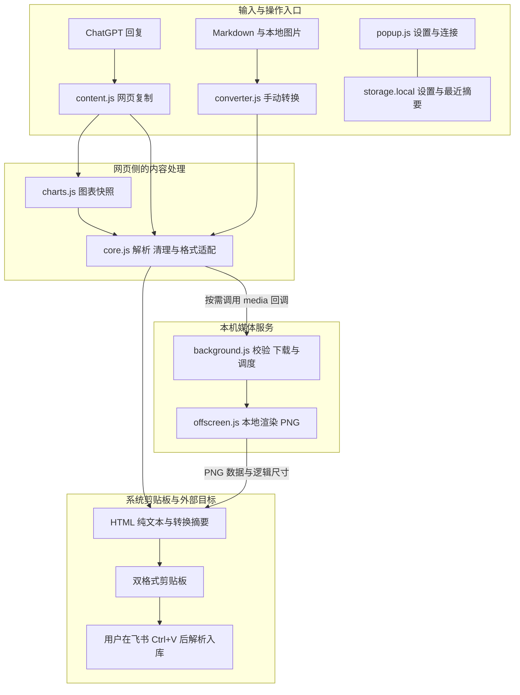
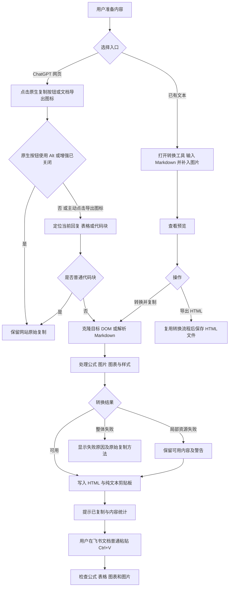
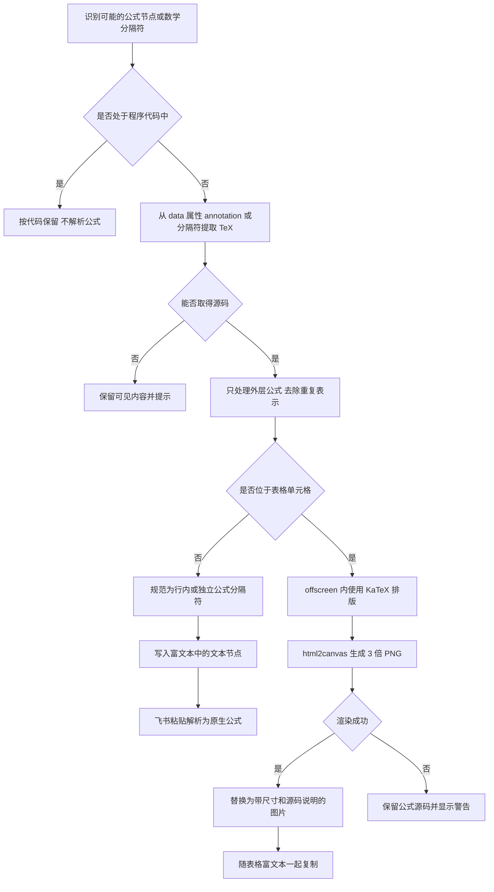
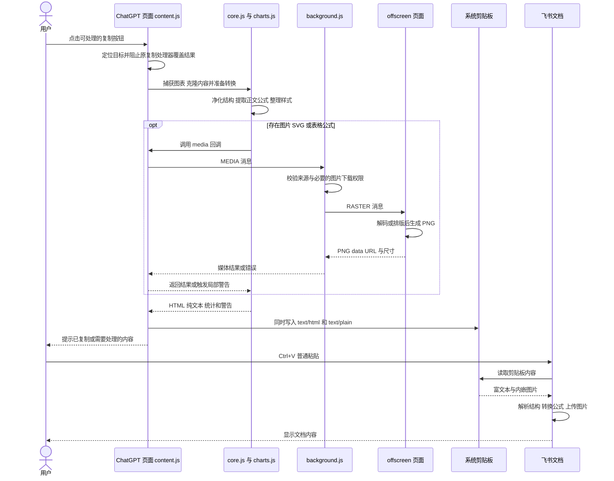
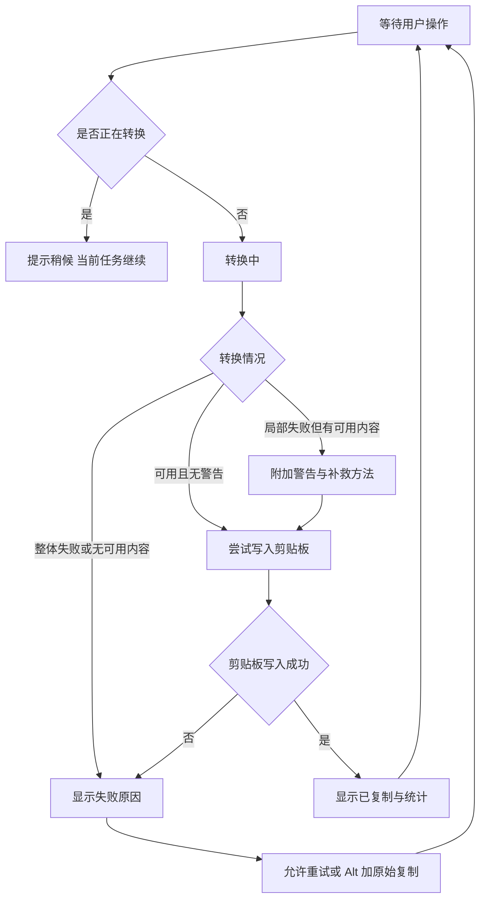

# ChatGPT 到飞书复制插件产品需求文档

| 项目 | 内容 |
| --- | --- |
| 产品 | ChatGPT → 飞书 · 公式图片复制 |
| 文档版本 | 1.0 |
| 对应软件版本 | v1.1.2 设计基线；v1.2.0 会话导出见补充文档 |
| 更新日期 | 2026-10-20 |
| 基线 | 仓库提交 `0fe3f37` 的实际实现 |
| 读者 | 产品、研发、测试、开源贡献者及插件使用者 |
| 项目地址 | https://github.com/YijiaQian/chatgpt-feishu-copy |

## 1 产品定位与问题

本产品是运行在 Chrome / Edge 中的浏览器扩展，把用户主动选择的 ChatGPT 回复或 Markdown 转换为适合飞书文档粘贴的富文本。用户点击复制，等待转换完成，再在飞书按 Ctrl+V；无需配置模型 API、飞书应用或服务端。

“粘贴不乱码”在本项目中包括四类问题：中文和符号损坏，Markdown 结构丢失，LaTeX 变成错误源码或重复文字，以及图片、图标、图表只剩占位符。它们需要分别处理，不能只靠设置 UTF-8 解决。

当前方案保留可编辑的正文和公式，并把目标粘贴流程难以直接表达的内容转成图片。表格内公式和交互图表采用图片后，可以保留可见内容，但分别失去公式编辑能力和鼠标交互能力。第三方网页的粘贴解析由飞书控制，本产品以经过验证的内容类型和明确的失败提示作为兼容性边界。

### 目标用户和使用场景

| 用户 | 典型场景 | 核心诉求 |
| --- | --- | --- |
| 学生、研究人员 | 整理数学推导、论文笔记 | 公式不重复，正文公式可继续编辑 |
| 算法和工程人员 | 保存技术解答、训练原理和代码 | 公式、代码、曲线图同时保留 |
| 产品和知识管理人员 | 把 AI 生成内容整理进团队知识库 | 标题、列表、表格结构可用，减少二次排版 |
| 已有 Markdown 的用户 | 处理历史文本和本地图片 | 不依赖原对话也能转换已有内容 |

## 2 目标与范围

### 本版本目标

1. 延续 ChatGPT 原有复制习惯，提供原生按钮增强和简洁的文档导出图标。
2. 复制范围准确，只处理目标回复、目标表格或 Markdown 代码块。
3. 对已支持的内容保留结构、源码或图像，不把不可转换内容悄悄忽略。
4. 转换在本机完成；图片请求、剪贴板写入和本地记录向用户说明。
5. 提供可维护的开源代码、测试、打包和商店提交材料。

### 范围边界

| 当前支持 | 当前限制 |
| --- | --- |
| Chrome / Edge 中的 ChatGPT 网页 | 手机端、ChatGPT 桌面客户端未覆盖 |
| 用户主动触发的单次复制 | 不自动批量归档全部对话 |
| 正文公式转为飞书原生公式 | 表格公式目前以高清图片保留 |
| 可读取的 SVG / Recharts / Canvas 图表 | 不保留交互；跨域 iframe 图表不直接抓取 |
| Markdown 转换和本地图片补入 | 纯文本中的 `Chart` 占位符不能还原原图 |
| 用户自行 Ctrl+V 粘贴到飞书 | 扩展不调用飞书 API，不自动写入目标文档 |

## 3 总体架构

系统分成网页侧、扩展页面、扩展后台和目标文档四部分。核心转换器被网页复制与独立 Markdown 工具复用；飞书属于外部目标系统，负责最终导入和图片上传。



[查看架构图大图](assets/prd/01-architecture.svg)

图中的 `CORE → BG` 是逻辑调用关系：`core.js` 接收入口注入的 `media` 回调；`content.js` 或 `converter.js` 才负责发送浏览器扩展消息。PNG 经后台和调用入口返回核心转换器后合并进结果，完整返回时序见第 6 节。这样核心结构转换不直接依赖消息传输，可在本地测试中注入模拟媒体服务。设置和最近摘要由对应入口读写，图中仅简化展示存储组件。

### 组件职责与源码映射

| 组件 | 主要功能 | 输入与输出 |
| --- | --- | --- |
| `manifest.json` | 声明 MV3、网站权限、脚本、后台和扩展页面 | 决定扩展能在哪些网页运行 |
| `content.js` | 识别复制按钮、定位回复、捕获点击、编排转换、展示提示 | 当前按钮和目标 DOM → 转换结果与剪贴板 |
| `charts.js` | 检测图表，保留 SVG 样式、图例和坐标，读取 Canvas | 图表 DOM → PNG 快照映射与警告 |
| `core.js` | Markdown 解析、DOM 克隆、公式提取、净化、图片替换、样式整理、剪贴板写入 | DOM / Markdown → HTML、纯文本、统计和警告 |
| `background.js` | 校验消息来源和图片域名权限、下载素材、创建及调用 offscreen 页面 | `MEDIA` 请求 → 媒体处理结果 |
| `offscreen.js` | KaTeX 渲染表格公式，解码和栅格化图片及 SVG，排队处理 | `RASTER` 请求 → PNG data URL 和尺寸 |
| `popup.html`、`popup.js` | 功能开关、最近统计、连接状态、手动重新连接 | 设置变更和 `CFB_PING` 检查 |
| `converter.html`、`converter.js` | Markdown 输入、公式预览、本地图片、域名授权、复制和 HTML 导出 | 手工内容 → 相同核心转换流程 |
| `privacy.html`、`PRIVACY.md` | 说明数据处理、保留、网络请求和删除方式 | 扩展内说明及公开政策 |
| `tests/`、`.github/workflows/check.yml` | 验证转换和运行自动检查 | 本地夹具 → 测试结果与构建附件 |
| `scripts/package.py` | 根据固定文件清单生成安装包和校验文件 | 源码 → 商店包、手动安装包、SHA-256 |

生产环境没有自建后端、数据库或飞书 API 网关。测试中的 Python 本地 HTTP 服务只用于开发验证。

### 本地依赖

| 依赖 | 用途 |
| --- | --- |
| markdown-it | 把 Markdown 结构解析为 HTML，接入自定义数学语法 |
| DOMPurify | 清理 HTML / SVG 中的脚本、危险属性和不允许的元素 |
| KaTeX 与本地字体 | 转换工具预览、表格公式的本地排版 |
| html2canvas | 对 offscreen 中已渲染的表格公式生成 3 倍 PNG |
| 浏览器 Canvas / SVG / Clipboard API | 图表绘制、图片编码、富文本剪贴板写入 |

`html2canvas` 不用于对整个 ChatGPT 页面截图。图表采用定向 SVG / Canvas 捕获，避免克隆整个长对话引起卡顿。

## 4 用户操作流程



[查看操作流程大图](assets/prd/02-user-flow.svg)

增强开关控制的是原生复制按钮的接管行为。新增文档导出图标是主动转换入口；当前实现中，即使关闭原生按钮增强，点击该图标仍会转换。Alt 还原原始复制适用于网站原生按钮。

独立工具预览用于检查内容和公式语法，不代表飞书最终排版。用户应使用普通粘贴 Ctrl+V；“仅粘贴纯文本”会丢弃富文本格式和嵌入图片。

## 5 核心转换规则

### 5.1 精确定位复制内容

原生复制按钮通过 `data-testid`、可访问名称、标题和图标识别。定位时兼容旧版 `data-message-author-role` 和新版 `data-turn-key`、`assistant-message` 结构；同一 turn 同时包含用户和助手时，应选取助手消息根节点，避免把提问一起复制。

表格区域的复制只转换该表格。Markdown 代码块可以作为 Markdown 转换；普通程序代码块保留原网站复制，防止把代码字符串里的美元符号误识别为公式。无法定位可处理来源时，原生按钮事件继续走网站流程。

v1.2.1 更新：普通程序代码块的复制也增强为富文本，输出飞书原生代码块及语言标记，纯文本仍为原始源码；代码内部继续跳过公式解析。以上保留网站代码复制的描述及流程图分支属于 v1.1.2 设计基线，当前行为以 README 为准。Alt 点击保留网站原始复制。

### 5.2 内容类型与目标格式

| 源内容 | 中间处理 | 飞书中的预期结果 | 编辑能力 |
| --- | --- | --- | --- |
| 中文、英文、标点、Emoji | 保持 Unicode，按 HTML 规则转义必要字符 | 文本和字符 | 可编辑；字形取决于系统字体 |
| 标题、段落、粗斜体、链接 | 保留语义标签并整理内联样式 | 对应文本结构 | 可编辑 |
| 列表、引用 | 保留列表层级和引用结构 | 对应文档结构 | 可编辑 |
| 程序代码 | 保留 `pre/code` 和语言标记，跳过公式转换 | 代码内容 | 可编辑 |
| 正文行内 / 独立公式 | 提取 TeX，分别规范成 `$…$` / `$$…$$` 文本 | 经已验证的飞书粘贴转换形成原生公式 | 可编辑 |
| 表格中的公式 | KaTeX 排版 → 3 倍 PNG | 单元格内图片 | 图片可替换，公式不可直接编辑 |
| 表格 | 保留 `table/tr/td/th`，设置 `ace-table` | 原生文档表格 | 表格和普通文本可编辑 |
| 普通图片、生成图片 | 读取实际资源，解码并嵌入 PNG | 文档图片 | 可调整图片 |
| SVG 图标 | 清理危险内容并栅格化 | PNG 图标 | 位图 |
| 可读取的交互图表 | 捕获图形、样式、坐标和图例 | 静态 PNG | 不保留交互和原始图表数据 |

`ace-table` 及 `data-lark-image-width/height` 是当前适配采用的导入标记，不构成飞书公开稳定协议。飞书更新解析逻辑后，需要重新验证。

### 5.3 公式处理流程



[查看公式流程大图](assets/prd/03-formula-flow.svg)

关键实现是先提取 TeX，再替换公式节点。ChatGPT 的 KaTeX 渲染通常同时存在可见 HTML 和给辅助技术使用的 MathML；直接取整段文字容易得到重复上下标、重复公式或错序字符。处理最外层公式并去重，可以避免把这些表示层一起复制。

正文公式不要求飞书读取 KaTeX 的 CSS，也不依赖把 MathML 直接导入。表格公式在当前已验证粘贴流程中不能依靠同一套自动转换，因此转成图片。图片 `alt/title` 在兼容 HTML 内保留源码，但飞书不一定保留这些说明；后续需要修改表格公式时，应保留原 Markdown 或导出的 HTML。

### 5.4 图片与图表处理

图片优先从网页侧读取实际 `currentSrc`、HTTPS 或可读取的 blob 资源；需要时转交后台，校验域名权限后下载。data URL 可以直接进入本地解码。外部域名后台下载失败时，由用户在转换工具中对该域名单独授权；过期、受权限限制或不可读取的素材需要用户补入本地原图。

图表快照在克隆内容前生成。`charts.js` 先识别 Recharts 等图表容器或尺寸符合条件的 SVG / Canvas，复制 SVG 的计算样式，再将图形与 HTML 图例绘制到 Canvas。轴标签增加边距，隐藏的数据表和 tooltip 不作为正文复制。生成的快照替换原图表节点，避免最后只剩“Chart”、图例和坐标文字。

若用户只有一段纯 Markdown，其中只包含 `Chart` 和图例，原始曲线数据并不存在于输入中，产品应提示回到原网页复制或补入图片。不能凭这些文字推断并冒充原图。

### 5.5 结构整理和富文本生成

转换器先净化输入，再清除按钮、表单、脚本、iframe、辅助隐藏数据和工具栏；可点击图片卡片中的实际图片会被保留。最后使用标准 HTML 标签和必要的内联样式整理内容，减少对 ChatGPT 页面 CSS 的依赖。

生成结果包含以下逻辑字段：

```text
ConversionResult
  html              飞书粘贴使用的 HTML 结构和内嵌图片
  text              纯文本表示 供不接收富文本的目标使用
  stats
    formulas        已提取的公式总数 包含表格公式
    tableFormulas   成功转为图片的表格公式数
    images          成功嵌入的普通图片与图表快照数
    icons           成功栅格化的 SVG 图标数
    charts          网页入口捕获的图表快照数
  warnings          内容缺失 资源失败或需要手工处理的提示
```

这些计数存在包含关系，不能全部相加当作内容总数。`charts` 由网页入口补入；转换工具不具备从纯文本恢复原网页图表的能力。

## 6 复制到粘贴的时序



[查看时序图大图](assets/prd/04-copy-sequence.svg)

网页入口在捕获阶段接管目标点击，调用 `preventDefault` 和 `stopImmediatePropagation`，防止原网站随后又把普通文本写回剪贴板。转换成功只代表剪贴板已写入；扩展不持有飞书文档编辑器连接，不能据此声称目标文档已保存。

优先使用 `ClipboardItem`，一次写入 `text/html` 和 `text/plain` 两种表示。旧接口降级路径仍尝试同时写入两种格式。浏览器安全策略或企业策略阻止剪贴板时，应报告失败，而非显示复制成功。

## 7 如何减少乱码和格式丢失

| 问题来源 | 对应机制 | 仍需注意 |
| --- | --- | --- |
| 中文、符号被错误编码或 HTML 误解析 | 保持 Unicode；HTML 带 UTF-8 声明；必要字符进行转义 | 已经损坏的输入不能自动恢复；字体缺失可能影响字形 |
| Markdown 标记作为普通文字粘贴 | 先解析为语义 HTML，再写入富文本剪贴板 | 仅粘贴纯文本会失去结构 |
| 公式上下标错序、内容重复 | 提取 TeX 源码、处理外层节点并去重 | 无源码或语法不受支持时需要手工修正 |
| 公式反斜杠被误处理 | 四种数学分隔符专门解析，代码区跳过，源码按文本节点保留 | 不对任意文本做全局反斜杠替换 |
| 表格内显示美元符号和 LaTeX | 表格公式本地排版后转 PNG | 公式变为图片，不能直接编辑 |
| 图片链接过期或目标端无登录权限 | 尽量把可读取资源转为内嵌 PNG | 转换时就无法读取的图片仍需补入原图 |
| 图表只剩图例、轴数值或占位符 | 在原页面捕获图表，整体替换为快照 | 纯 Markdown 或跨域 iframe 不保证可捕获 |
| 样式依赖原网页 CSS | 精简语义标签、统一必要内联样式、保留尺寸 | 不承诺和 ChatGPT 逐像素相同 |
| 原按钮再次覆盖剪贴板 | 捕获阶段拦截目标点击 | 无法定位目标的点击不接管 |

UTF-8 声明主要提供明确的 HTML 编码信息；实际兼容性还依赖结构转换、公式策略、素材可读取性和飞书的导入行为。产品验收必须查看最终粘贴结果。

## 8 功能需求与优先级

### 已实现功能

| 编号 | 优先级 | 需求及验收要点 |
| --- | --- | --- |
| FR-01 | P0 | 接管目标原生复制按钮；一次点击只复制当前目标，无用户提问或其他回复混入 |
| FR-02 | P0 | 规范正文公式并去重；支持四种分隔符；代码中的美元符号不变 |
| FR-03 | P0 | 表格保持表格结构，表格公式转清晰图片；渲染失败保留源码并提示 |
| FR-04 | P0 | 可读取图片、SVG 和图表嵌入；失败显示原因并尽可能保留原链接 |
| FR-05 | P0 | 同时写入 HTML 和纯文本；只有写入成功后显示“已复制” |
| FR-06 | P0 | 保留普通代码复制和 Alt 原始复制；未识别的内容不接管 |
| FR-07 | P1 | 新增图标沿用原生工具栏样式，有悬停提示和可访问名称 |
| FR-08 | P1 | 独立 Markdown 工具支持输入、预览、本地图片、复制、HTML 导出和域名授权 |
| FR-09 | P1 | 弹窗显示开关、最近统计和连接版本，并提供手动重新连接 |
| FR-10 | P0 | 隐私说明可访问；功能所需权限明确；无开发者收集服务和遥测 |
| FR-11 | P1 | 提供开源许可、自动检查、商店包、手动包与校验文件 |

优先级定义：P0 影响内容正确性、复制可用性或数据处理；P1 影响使用效率、可理解性和维护。

### 后续规划 尚未实现

| 优先级 | 方向 | 完成条件或代价 |
| --- | --- | --- |
| P1 | 提高错误定位能力 | 指出具体失败资源，帮助用户按顺序补入图片，并避免记录私密内容 |
| P1 | 扩展回归样本 | 为更多图表库、长表格、嵌套列表及网页结构变化提供脱敏夹具 |
| P1 | 增强任务进度和取消 | 逐项显示媒体处理进度；取消后不写入不完整结果 |
| P1 | 建立性能基准 | 定义代表性文本、公式和图片样本，记录转换耗时与内存；当前没有量化 SLA |
| P2 | 提供可编辑表格公式方案 | 先验证更稳定的目标端导入能力；若采用飞书 API，需要单独设计认证、权限和目标文档选择 |
| P2 | 自动验证目标粘贴结果 | 需要目标端适配和用户授权；当前扩展只确认剪贴板写入 |
| P2 | 更广客户端兼容 | 分别验证 Edge、飞书桌面端、其他浏览器和不同组织策略 |

这些规划不计入 v1.1.2 已交付能力，也不构成已确定的发布日期承诺。

## 9 状态与异常处理



[查看状态图大图](assets/prd/05-status-flow.svg)

| 异常 | 当前行为 | 用户补救 |
| --- | --- | --- |
| 页面未连接扩展 | 弹窗显示未连接；无法增强当前原按钮 | 刷新或“检查并启用当前页面” |
| 同时重复点击 | 提示上一次仍在转换 | 等待当前任务结束 |
| 图片无法下载或未授权 | 保留可用正文，报告失败；可保留原图链接 | 按域名授权、等待加载或补入本地原图 |
| 表格公式渲染失败 | 保留源码和警告 | 修正语法或拆分公式 |
| 图表不可读取 | 说明截图失败或 iframe 限制 | 使用图表原有下载能力，再插入图片 |
| 只有 Chart 占位符 | 提示输入缺少图表数据 | 回原始对话复制 |
| 超出资源限制 | 拒绝对应操作，或对失败媒体给出警告 | 缩小图片或分段复制 |
| 剪贴板被阻止 | 报告复制失败 | 保持页面前台、检查策略或使用原始复制 |

## 10 性能与资源边界

当前转换采用有限、顺序的媒体处理；offscreen 渲染任务也排队执行。目标是避免同时解码大量图片导致消息和内存峰值，不承诺固定的转换秒数。

| 限制 | 当前实现 |
| --- | --- |
| Markdown 输入 | `parseMarkdown` 对超过约 200 万字符的输入拒绝处理；不是所有 DOM 输入的统一长度限制 |
| 单个公式 | 超过 16000 字符提示；表格公式超长不进行渲染 |
| 原图下载 / 本地文件 | 常规路径限制约 16 MB |
| 图片像素 | 普通图片解码限制 6400 万像素；输出通常缩到宽度不超过 2000 像素、约 800 万像素内 |
| 图片逻辑显示宽度 | 通常不超过 720 像素，配合显示尺寸属性 |
| 输出 PNG | 普通媒体分支对过大编码结果拒绝处理 |
| 嵌入总量 | 约 24 MB 的 data URL 字符计数预算；不是精确的二进制文件体积或进程内存上限 |
| 图表快照 | 约 2 倍分辨率；过大容器拒绝；保留轴标签边距 |
| 表格公式快照 | 3 倍分辨率，按逻辑尺寸显示 |

当前总量控制主要在媒体逐项嵌入时执行，不能把它当成针对任意输入的完整内存保护。大量表格公式、超长 DOM 等场景仍应纳入后续性能和边界测试。

## 11 权限与数据流

| 数据或权限 | 用途与边界 |
| --- | --- |
| ChatGPT 网站访问 | 识别目标回复、复制按钮和素材；不遍历其他站点的浏览历史 |
| 固定 OpenAI 素材域名 | 按需下载回复引用的图片 |
| 可选 HTTPS 域名权限 | 用户主动输入域名后申请，为后台下载外部图片服务 |
| `clipboardWrite` | 用户主动复制后写入两种格式；没有申请 `clipboardRead` |
| `offscreen` | 本机 DOM 渲染和图片转换，不等于远程服务 |
| `scripting` | 用户主动重新连接已授权的 ChatGPT 网页 |
| `storage.local` | 开关及最近一次转换时间、统计、警告；新记录覆盖旧记录 |

警告可能包含图片说明、域名或出错公式片段；不把完整正文、图片和 Markdown 草稿持久保存。素材原服务器仍可能收到正常请求信息，同源素材请求可能使用浏览器已有会话。转换页预览也可能直接加载用户 Markdown 中的远程图片。

飞书收到内容发生在用户粘贴之后，由飞书自己上传和保存。剪贴板、导出的 HTML、目标文档和浏览器缓存不随卸载扩展一并删除。完整口径以项目 [隐私说明](../PRIVACY.md) 为准。

## 12 验收标准与已有证据

### 功能验收

| 场景 | 通过标准 |
| --- | --- |
| 中英文与 Emoji | 输出无因转换产生的替换字符；标点和源码未被错误转义 |
| 回复定位 | 不含用户提问、其他回复、复制工具栏或隐藏数据 |
| 正文公式 | 内容只出现一次；目标飞书公式与 TeX 数学含义一致且可编辑 |
| 表格公式 | 单元格结构保留，图片完整、清晰，无多余美元符号源码 |
| 图片与图标 | 可读取资源嵌入成功；失败有可操作提示 |
| 交互图表 | 曲线、坐标轴、负数 / 小数轴标签及图例可见，无只有文字的假成功 |
| 代码 | 源码和语言标识保留；字符串中的美元符号不变 |
| 原始复制 | 普通代码和 Alt 点击不被增强逻辑覆盖 |
| 剪贴板与反馈 | 两种 MIME 存在；原网站处理器不覆盖转换结果；写入失败不报成功 |
| 目标文档 | 用普通 Ctrl+V 实际粘贴并检查；剪贴板检查不能替代目标验收 |

### 已有验证记录

- 2026-10-19：15 项内核检查、4 项原有按钮集成检查、2 项新版结构与图表集成检查通过。
- 已完成一组真实 ChatGPT 原生复制 → 飞书浏览器 Ctrl+V → lark-cli 回读的验收。来源包含 35 个公式，其中 4 个是表格公式，并包含 2 张曲线图；目标保存为 31 个原生公式和 6 个图片块。
- 上述 6 个图片块由 4 张表格公式图与 2 张曲线图构成，不能再把图表数量与图片数量重复相加。
- v1.1.1 的新图标在真实网页点击复制通过；v1.1.2 的 15 项内核检查和 GitHub CI 通过。
- 真实网站验证环境为 Windows 11、Chrome for Testing 143 和飞书网页版；Edge 尚不具备同等的真实端到端验收记录。

这些结果覆盖明确的样本，不能推导为所有公式语法、所有图表库或所有飞书客户端都已通过。项目不公开私有原对话、测试文档链接或登录资料。

GitHub CI 运行的是本地夹具和打包检查，不会登录 ChatGPT 或飞书执行在线粘贴。参考 [已通过的发布检查](https://github.com/YijiaQian/chatgpt-feishu-copy/actions/runs/39364188157)。

## 13 发布与维护

当前按 MIT 开源，依赖遵守各自许可证。本 PRD 主体记录 v1.1.2 的设计基线；当前版本以 manifest 为准，新增整段会话导出能力见[补充设计](conversation-export.zh-CN.md)。

发布流程为：源码检查 → 本地回归 → GitHub CI → 生成包和 SHA-256 → 核对文件 → GitHub Release。商店专用 ZIP 将 `manifest.json` 放在根目录；手动包使用 `chatgpt-feishu-copy` 文件夹，并包含使用和开发文档。商店包不包含测试和开发文件。

Chrome / Edge 商店发布材料见 [商店说明](store-listing.zh-CN.md)。目前尚未提交商店审核。后续遇到 ChatGPT DOM 或飞书导入变化时，应优先复现并补充脱敏夹具，再更新适配器和兼容性记录。

## 14 技术参考

- 实现入口：[content.js](../content.js)、[charts.js](../charts.js)、[core.js](../core.js)。
- 媒体处理：[background.js](../background.js)、[offscreen.js](../offscreen.js)。
- 手动工具：[converter.js](../converter.js)；权限配置：[manifest.json](../manifest.json)。
- [GitHub Mermaid 图表说明](https://docs.github.com/en/get-started/writing-on-github/working-with-advanced-formatting/creating-diagrams)：本文件中的流程图可以直接在 GitHub Markdown 中查看。

本文中的外部粘贴行为以项目实测样本为依据；内部职责和分支以 v1.1.2 源码为依据。后续软件改变时，应同步更新能力、限制及验收记录。
