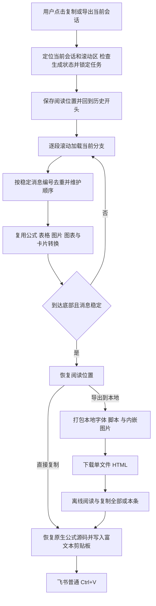

# 当前会话复制与离线导出

扩展弹窗提供两个入口。「复制当前会话到飞书」将当前分支的双方消息按顺序写入剪贴板。「导出当前会话到本地」保存单文件 HTML，供离线阅读和复制全部或单条消息。

## 处理流程

## 组件职责

| 组件 | 职责 |
| --- | --- |
| `popup.js` | 直接复制和离线导出的入口，连接当前 ChatGPT 标签页 |
| `content.js` | 共用会话采集、进度与取消，完成后写入剪贴板或下载文件 |
| `conversation.js` | 确定当前会话及滚动区域，加载虚拟滚动历史，按稳定编号去重并恢复阅读位置 |
| `core.js` / `charts.js` / `offscreen.js` | 原生公式源码、表格公式图片、正文图片、图表与完整卡片布局 |
| `background.js` | 读取固定本地查看资源并内嵌 WOFF2 字体，沿用已有图片下载能力 |
| `archive.js` | 为两条路径生成正文、消息标题及来源信息，并组装离线 HTML |
| `archive-clipboard.js` | 输出两种剪贴板格式，检查大小限制，去掉查看界面并恢复 LaTeX |
| `archive-viewer.js` | 离线公式预览，以及复制全部或单条消息 |

## 格式与完整性

- 同一句重复提问按不同消息分别保留，不能按文字内容去重。
- 根据主视图中的消息所属容器确定会话范围。页面提供会话 ID 时，优先使用与 URL 匹配的容器。侧栏、搜索和对话框内的会话预览不参与采集。若存在多个候选范围且无法区分，操作会在转换消息前停止。
- 先跳到顶部。如果页面恢复到较低的滚动位置，扩展会分步上滚。自动找不到开头时，进度面板提示用滚轮到顶，顶部消息加载完成后继续原任务。扩展逐段向下采集，等底部内容稳定才完成。扫描超限、取消或消息顺序冲突都会停止，剪贴板和下载目录不会收到不完整的会话。
- 对使用虚拟列表的页面，扩展会比对当前扫描区与已显示消息的范围。当前扫描区仍有未加载的占位时，扩展会等待。等待超时后停止，并提示手动滚过空白区域。
- 不通过网站私有会话 API 获取隐藏数据。范围是当前分支的网页消息；不导出其他会话、未选择分支、隐藏思考过程和附件原文件。识别到的附件名称可保留并提示。
- 消息 ID 用来去重。导出优先读取有正文标记的内容和可识别的媒体。缺少正文标记时，扩展也会识别助手消息中的旧格式正文。仅有消息 ID 的容器可能是思考摘要或进度提示，不能仅凭 ID 把容器内的文字计作回复。
- 离线文件和剪贴板都用二级标题标出每条消息，正文的小标题从三级开始。用户消息的可见换行转为 HTML 换行。复制全部或本条时去掉离线排版外框，保留消息标题和正文。已导出的旧文件须从原会话重新生成。
- 每条消息复用现有飞书兼容转换。正文公式在文件内用 KaTeX 显示，复制时恢复为 LaTeX 分隔符；卡片、图表和表格公式保持图片。
- 可读取图片、字体和脚本均内嵌。离线文件设置 CSP 阻止网络资源加载，允许带 nonce 的固定本地脚本；引用链接仍可由用户主动打开。
- 本地文件包含完整正文和来源会话地址。扩展存储只保留统计及警告，不持久保存完整会话。
- 单次最多 2000 条消息，转换内容与最终文件各限制约 128 MB，单条消息的媒体上限为 24 MB。直接复制的富文本超过 24 MB 时，改用本地导出并分条复制。若浏览器拒绝写入剪贴板，页面会显示失败提示，可保持网页在前台后重试。

## 验收

自动化覆盖消息识别、图文混排与纯图片回复、重复提问、虚拟滚动历史、顺序恢复、取消、扫描不完整、生成中拦截、离线公式显示和复制还原。合并原有转换测试共 31 项，另通过原有按钮/图表集成检查与真实取消按钮检查。

在真实已登录会话中，从扩展按钮导出 14 条消息（用户 8 条、ChatGPT 6 条）。文件断网打开后，26 个公式和 8 张内嵌图片全部可见；从文件“复制全部到飞书”并普通 Ctrl+V 后，回读确认为 26 个原生公式、8 个图片块，角色数量及顺序保持一致。仓库不包含私有对话、测试文档地址、浏览器配置或私有验收 HTML。
