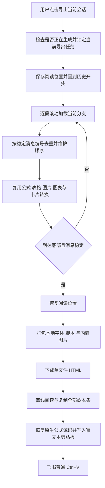

# 当前会话离线导出 · v1.2.0

在已有 ChatGPT 网页会话中，点击扩展弹窗的“导出当前会话到本地”，把当前分支的双方消息按顺序保存为单文件 HTML。打开文件后可离线阅读，并复制全部或单条消息到飞书。

## 处理流程

## 组件职责

| 组件 | 职责 |
| --- | --- |
| `popup.js` | 导出入口，连接当前 ChatGPT 标签页 |
| `content.js` | 任务互斥、进度与取消，复用现有转换，触发下载 |
| `conversation.js` | 发现双方消息、加载虚拟滚动历史、以稳定编号去重、维护顺序、恢复位置 |
| `core.js` / `charts.js` / `offscreen.js` | 原生公式源码、表格公式图片、正文图片、图表与完整卡片布局 |
| `background.js` | 读取固定本地查看资源并内嵌 WOFF2 字体，沿用已有图片下载能力 |
| `archive.js` | 组装安全的离线 HTML、来源与角色信息、警告和文件名 |
| `archive-viewer.js` | 离线公式预览、复制全部和单条消息；复制时移除查看界面并恢复 LaTeX |

## 格式与完整性

- 同一句重复提问按不同消息分别保留，不能按文字内容去重。
- 通过反复到顶和逐段向下扫描处理历史加载；底部内容稳定后才完成。超出扫描上限或消息顺序冲突时失败，不下载部分会话冒充完整结果。
- 不通过网站私有会话 API 获取隐藏数据。范围是当前分支的网页消息；不导出其他会话、未选择分支、隐藏思考过程和附件原文件。识别到的附件名称可保留并提示。
- 每条消息复用现有飞书兼容转换。正文公式在文件内用 KaTeX 显示，复制时恢复为 LaTeX 分隔符；卡片、图表和表格公式保持图片。
- 可读取图片、字体和脚本均内嵌。离线文件设置 CSP 阻止网络资源加载，允许带 nonce 的固定本地脚本；引用链接仍可由用户主动打开。
- 本地文件包含完整正文和来源会话地址。扩展存储只保留统计及警告，不持久保存完整会话。
- 单次最多 2000 条消息，转换内容与最终文件各限制约 128 MB；单条媒体沿用 24 MB 限制。超大剪贴板内容提示改用分条复制。

## 验收

自动化覆盖消息识别、图文混排与纯图片回复、重复提问、虚拟滚动历史、顺序恢复、取消、扫描不完整、生成中拦截、离线公式显示和复制还原。合并原有转换测试共 31 项，另通过原有按钮/图表集成检查与真实取消按钮检查。

在真实已登录会话中，从扩展按钮导出 14 条消息（用户 8 条、ChatGPT 6 条）。文件断网打开后，26 个公式和 8 张内嵌图片全部可见；从文件“复制全部到飞书”并普通 Ctrl+V 后，回读确认为 26 个原生公式、8 个图片块，角色数量及顺序保持一致。仓库不包含私有对话、测试文档地址、浏览器配置或私有验收 HTML。
